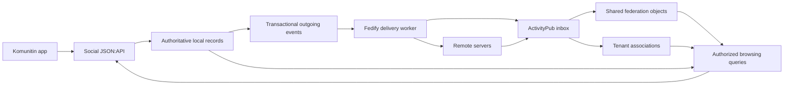

# Social federation architecture

Status: implementation architecture; federation is not implemented yet.

Date: 2026-10-10.

This document defines the direction for federation in Komunitin's social service. It combines the federation research, the supplied “Annex III: Technical Architecture”, and the subsequent decisions about same-server delivery, historical synchronization, withdrawal and audience isolation. Exact wire-profile details that require interoperability testing are identified below.

## 1. Purpose and initial scope

A community's members must be able to discover public offers and wants from other communities, whether those communities share their Komunitin server, use another Komunitin server, or use a compatible platform. Communities remain independent units of membership, publication and moderation. Hosting several communities on one server must not give them additional access to one another's data.

The first release provides:

- Community discovery by URL or handle, and discovery of public communities hosted locally.
- Community subscriptions managed by community administrators.
- Publication and reception of public offers and wants, with a readable representation for general social applications.
- A community-scoped browsing and search API combining its own content with selected federated content.
- Historical import of active listings, ongoing updates, withdrawals and periodic reconciliation.
- Per-community moderation and operational controls.

Existing `access: group` content remains available through its existing local membership rules. It is not federated initially. The existing `private` API value and owner/admin access paths retain their current meaning.

Restricted sharing with partner communities, arbitrary selected communities or individual members is a future feature. The first release establishes the storage and authorization boundaries needed for it, without implementing its complete permissions engine or audience picker. Personal following workflows, direct messages, remote posting into local communities, replies and other social interactions are also deferred.

Embeddings, semantic search, model inference and AI recommendations are outside this architecture. Federation does not depend on pgvector or an inference service.

## 2. Main decisions

| Area | Decision |
| --- | --- |
| Federation protocol | ActivityPub server-to-server, using ActivityStreams 2.0 objects. |
| Implementation library | Fedify, integrated into the existing TypeScript/Node.js/Express social service. |
| Client API | Preserve JSON:API, OAuth2/JWT authorization and OpenAPI documentation; do not implement ActivityPub client-to-server as a replacement. |
| Subscription unit | A community is a followable `Group` actor, independent of its hosting server. |
| Authorship | Preserve member-profile authorship through `Person` or `Organization` actors. Login users remain internal identities. |
| Same-server delivery | Use the actual ActivityPub delivery and ingestion path between co-hosted communities from the beginning. |
| Content representation | Readable `Note` objects plus a documented marketplace profile. Reuse Valueflows where the mapping is accurate. |
| Storage | One shared federation object per canonical object URI, with tenant-specific associations. Local domain records remain authoritative. |
| Authorization | Separate storage, tenant association, audience authorization and local moderation. Shared storage never grants access by itself. |
| Synchronization | Live activities plus a discoverable catalogue of active listings, initial backfill and reconciliation. |
| Reliability | Transactional outgoing events, persistent processing, idempotency and recipient delivery tracking. |
| Operations | Fully self-hostable open-source components, Docker deployment, and a PostgreSQL-backed queue as the initial default. |

[ActivityPub](https://www.w3.org/TR/activitypub/) fits the existing service because federation can be added alongside the application API. Fedify supplies [Express integration](https://fedify.dev/manual/integration) and [persistent PostgreSQL queues](https://fedify.dev/manual/mq) without requiring another primary datastore.

The alternatives considered were AT Protocol, Nostr, Matrix, feed syndication and a custom Komunitin federation API. ActivityPub is selected for its actor/subscription model, existing community applications and extensible content. This decision does not imply universal compatibility: transport, readable content, community distribution and structured marketplace semantics are separate compatibility targets.

## 3. Existing service and boundaries

The implementation extends `social/`, rather than introducing a second marketplace service:

- [Prisma schema](social/prisma/schema.prisma): communities are tenants; `Member` profiles may have several managing `User` identities; offers and wants share `Post`.
- [Tenant database clients](social/src/server/multitenant.ts): PostgreSQL RLS uses transaction-local tenant context and an explicit privileged path.
- [Post services](social/src/features/posts/service.ts) and [collection queries](social/src/features/posts/sql.ts): visibility, ownership, membership, publication status and expiry already affect reads.
- [Express application](social/src/app.ts): JSON:API routes and middleware need to coexist with federation endpoints.
- [File storage](docs/technology/social/README.md#files): uploaded images currently have public URLs, independently of their resource's access setting.

Authentication remains with the auth service. Social validates access tokens against the external identity service's JWKS and owns social authorization. Federation requests authenticate actors through Fedify's protocol machinery; they do not use remote users' Komunitin JWTs.

Accounting continues to own currencies, accounts and transfers. Following a community, receiving a remote actor or importing an offer must never create a local membership or accounting account. Seeing an offer does not establish currency acceptance, an exchange rate or permission to transact.

The existing API identifier `needs` is retained; the product term in this document is “wants”.

## 4. Actors, identity and subscriptions

### 4.1 Identity mapping

| Domain concept | Federation identity |
| --- | --- |
| Community | `Group` actor with its own inbox, outbox, keys and subscription relationships. |
| Personal member profile | `Person` actor. |
| Business or organization member profile | `Organization` actor. |
| Login user | No public federation identity merely because the login exists. |
| Published post | An addressable object attributed to its member actor and associated with its source community. |

Member actors initially provide authorship and the protocol endpoints needed for community publication. Their existence does not require implementing personal subscription management or messaging in the app. Only publish the actor fields needed for a public identity; do not serialize the complete local member record.

One human may manage several member actors, and several humans may manage one actor. A future share to a member means the member profile and its authorized managers, not necessarily one human login.

Use stable HTTPS URIs as federation identifiers. Keep actor, publication and activity identities distinct from mutable community codes, member codes and post slugs. Human-facing handles and URLs can change without changing canonical identifiers. Resolve handles with WebFinger; retain canonical actor URIs as database keys for federation relationships.

Namespace paths such as `/federation/actors/groups/{uuid}`, `/federation/actors/members/{uuid}` and `/federation/objects/{publicationUuid}` are implementation candidates, not a deployed URL contract. Fix the external origin and permanent paths before enabling production federation.

### 4.2 Community subscriptions

A local community administrator can subscribe its `Group` actor to another community actor. The receiver indexes the source's eligible publications into that local community's view. A subscription does not confer membership, publishing rights or access to restricted content.

Public community subscriptions use `Follow`, `Accept` and `Undo(Follow)`, with rejection or blocking where policy requires it. A Mastodon user following a Komunitin community and receiving its public publications is a first-release acceptance requirement.

Imported publications are not automatically re-announced to all followers of the receiving community. This avoids turning every subscription into a relay and prevents loops. Explicit redistribution is a separate future behavior.

Unfollowing stops future subscription delivery and removes that subscription's contribution to the community's browsing view. It does not assert that the source object has been deleted or become private. Other active associations may still justify displaying the same object.

### 4.3 Moving communities

Using the same protocol locally and remotely preserves behavior across hosting arrangements. It does not by itself solve migration. Canonical URLs, historical objects, signing keys and follower relationships need a separate migration design. Prefer preserving the public origin through routing or domain control where possible; do not promise that moving database rows changes federated identity transparently.

## 5. Federation wire profile

### 5.1 Readable marketplace objects

Publish offers and wants as `Note` objects with enough human-readable content to remain useful when extensions are ignored. Include an offer/want label, title where available, description, images, value text, appropriate public location and a link to the source. Include the title in rendered content as well as `name`.

Define the exact mapping for:

| Field | Representation rule |
| --- | --- |
| Identity and provenance | Canonical object URI, member actor URI, source community URI and original page URL. |
| Public addressing | Explicit ActivityStreams public addressing on the object and corresponding publication activities. |
| Offer or want | A documented machine-readable distinction, using the Valueflows/FEP-0837 offer/request semantics where applicable. |
| Value | Preserve the current free-text value. Add numeric quantity, unit or value only when explicitly represented in source data. |
| Currency and category | Globally identifiable references; local codes alone are insufficient. Preserve source category labels and allow explicit local mappings. |
| Lifecycle | Published/updated timestamps, expiry, and fulfilled/closed state with documented semantics. |
| Attachments and location | Explicit public projections, never an unrestricted serialization of related files or member addresses. |

[Valueflows proposals](https://www.valueflo.ws/concepts/proposals/) provide suitable offer/request concepts. [FEP-0837](https://codeberg.org/fediverse/fep/src/branch/main/fep/0837/fep-0837.md) is a useful marketplace profile to build upon, but is a draft as of this document's date. Current Komunitin posts do not contain all the structured intents, quantities and actions needed for its complete proposal and agreement model. Use accurate mappings and document the supported subset; do not claim full FEP-0837 conformance or invent missing economic data.

Define remaining terms and capability links in a stable Komunitin-controlled vocabulary namespace with a published JSON-LD context. Unknown optional fields should not prevent readable content exchange. Pin supported contexts and avoid arbitrary remote context fetching during ingestion.

ActivityStreams [`Offer`](https://www.w3.org/TR/activitystreams-vocabulary/#dfn-offer) is an activity type, not the chosen object type for a marketplace listing. The baseline remains `Note`, which is also a first-class payload in [Mastodon's implementation](https://docs.joinmastodon.org/spec/activitypub/#payloads).

### 5.2 Community distribution and authorship

Use [FEP-1b12 group federation](https://codeberg.org/fediverse/fep/src/branch/main/fep/1b12/fep-1b12.md) as the starting convention: the member authors the object, `audience` identifies its source community in this profile, and the community distributes the original activity inside an `Announce`. The FEP is final, but that does not mean every ActivityPub implementation supports its nested activity format.

The implementation must distinguish `Announce(Create(object))` from ordinary `Announce(object)` boosts. Receive both supported forms, preserve canonical identity and authorship, and verify the source community's announcement. Preserve signed wrapped activities intact; normalize a separate internal representation.

The prototype must determine the outgoing compatibility behavior required for Mastodon alongside a group implementation such as NodeBB or Lemmy. If ordinary object announcements are also necessary, use the same underlying object identity, prevent duplicate presentation, and specify how updates and withdrawals reach both types of recipient. Do not publish two independent copies under different authors merely to satisfy different clients.

[FEP-400e](https://codeberg.org/fediverse/fep/src/branch/main/fep/400e/fep-400e.md) is an alternative collection-based convention, not an interchangeable interpretation of FEP-1b12. It is not an initial requirement. [NodeBB's group documentation](https://docs.nodebb.org/activitypub/fep/1b12/) is an implementation reference for the selected approach.

The source-community use of ActivityStreams `audience` must not be confused with the future application authorization model. Followers, delivery addresses and membership grants are distinct concepts.

### 5.3 Incoming content

Classify a remote object as an offer or want only when a supported structured profile or explicit platform mapping establishes that meaning. A generic social `Note` must not become an offer merely because it contains a hashtag.

Keep generic posts distinguishable from marketplace listings in the normalized model and API. They may be shown as general community content or linked previews; an interface that supports only offers and wants must omit unsupported generic items rather than misclassify them.

An incoming public activity does not make its enclosed object public automatically. Validate the object's addressing and supported profile. Unsupported restricted objects must not enter the public pool; record only the operational metadata needed to explain rejection.

## 6. Same-server federation and service topology

Between communities on the same server, use signed ActivityPub delivery, inbox validation, persistence and tenant association, just as for remote communities. There is no initial cross-tenant post query or direct database insertion that bypasses this path to populate another community's feed.

Own-community CRUD and browsing continue to use the local domain API. A local community directory may identify available public communities without exposing their post tables. Reading another community's original public page remains an ordinary public read; importing it into a community view follows the federation path.

The worker-to-inbox path also represents delivery between co-hosted communities. A future transport optimization requires evidence of equivalent authorization, lifecycle and failure behavior; it is not part of the initial implementation.

Keep the federation adapter in the social codebase. The HTTP service and worker may run together for a small deployment or as separate processes from the same image. PostgreSQL is the initial durable queue and cache backend. Reuse S3-compatible storage for files. No central relay, proprietary service, separate search engine or additional database is required.

Mount federation and discovery routes before middleware that forces JSON:API response types or consumes bodies needed for signature verification. Follow Fedify's Express integration contract for request handling and content negotiation. Configure reverse-proxy trust and external URLs explicitly.

## 7. Data model: shared objects, tenant associations, audiences

### 7.1 Authoritative records and shared projections

Keep local `Post`, `Member` and `Group` records authoritative for editing and local administration. Do not create fake local members or posts to represent imported content: their existing foreign keys and lifecycle imply local membership and accounting relationships.

The shared pool stores a normalized federation projection, once per canonical object URI. It can hold projections of locally authored publications and cached remote publications. A local projection may reference its authoritative post through a tenant-owned publication record; incoming federation must never overwrite that source record.

The pool is an explicit exception to `tenantId` ownership. Tenant-owned records and access relationships have `tenantId` and RLS. Cross-tenant actor metadata, deduplication records and worker infrastructure have separately defined access policies, as existing cross-tenant identity and operational records already do.

The following are logical records; exact Prisma names and physical decomposition are implementation details:

| Record | Responsibility and ownership |
| --- | --- |
| Actor | Canonical URI, actor type, origin, verified public profile, endpoints and remote public keys. Shared metadata; presence grants no content access. |
| Local actor binding | Tenant-owned mapping from an actor to a local community/member. Signing material is protected operational data. |
| Publication | Tenant-owned link between a local post and a federation publication identity, revision and lifecycle. A post can have successive publication identities after withdrawal. |
| Federated object | Unique canonical URI, author/source provenance, normalized content, visibility, timestamps, availability, revision/freshness and tombstone state. No single owning recipient tenant. |
| Tenant object association | Tenant, object, source/subscription provenance, receipt state and local moderation. Supports multiple reasons for one tenant to know one object. |
| Subscription | Tenant-owned local actor relationship to a source actor, acceptance state and synchronization progress. |
| Receipt and delivery records | Activity identity, target actors/tenants, processing outcome and durable outbound delivery/retry state. |
| Audience grant, later | Object plus authorized community or member actor, provenance and revocation state. Distinct from a tenant association. |

Keep object identity independent of recipient identity. Fifty local communities receiving one offer produce one content projection and their associations, not fifty copies of the offer body. Preserve enough per-source association information that removing one subscription does not remove another legitimate path to the object.

Deduplicate both ingestion and presentation by canonical object URI. Never conflate a human-readable URL, an activity ID and an object ID. Do not deduplicate distinct publication identities merely because their text matches.

### 7.2 Access invariants from the first release

Ordinary reads of the pool require an eligible tenant association, an allowed audience and the tenant's moderation policy. In the first release, the only admitted federated audience is public. An association governs inclusion in a community view; it does not make otherwise public content confidential.

Enforce the association boundary in PostgreSQL, not merely by a repository-method convention. Prefer a pool RLS policy that checks eligible associations under the transaction's tenant context. A constrained database interface with direct pool access denied is an acceptable alternative. Applying RLS only to an association table while allowing unrestricted reads of the pool is insufficient. [PostgreSQL row-security policies](https://www.postgresql.org/docs/current/ddl-rowsecurity.html) support conditions involving related data.

Keep privileged ingestion, authoritative publication dispatch and administrative repair separate from ordinary browsing. Propagate tenant context through transactions and pooled connections. Extend the authorization context with viewer identity when restricted grants are introduced; do not make generic content reads privileged to accommodate federation.

Authorized objects must be the input to search, ordering, pagination, totals, relationship counts, category facets and suggestions. Filtering a broad result after querying can disclose information and break pagination. Detail endpoints, includes, serializers and caches must use the same access boundary.

Search runs on local authoritative records and normalized cached content using the existing PostgreSQL text/geographic capabilities. Remote network calls do not occur on the critical path of every feed or search request. Return origin information and freshness where useful, and keep local writable resources distinct from remote read-only projections in JSON:API.

### 7.3 Flexible audience model without implementing it now

Preserve three independent concepts in types and query interfaces:

1. The object and its authoritative origin.
2. The tenant association that makes it available to a community's service.
3. The audience that authorizes a particular viewer to read it.

Public visibility must be explicit, not inferred from an empty recipient list, a subscription or successful inbox delivery. Store canonical actor identities so future grants can refer to either communities or members, without requiring a local `Member` foreign key for every recipient.

The initial implementation needs shared objects, associations, provenance, public visibility and access-controlled reads. It does not need to populate a general audience-grant table, expose new access values or implement arbitrary policy expressions. Introduce grant persistence and evaluation together when restricted sharing is implemented.

The future authorization model is public access or an additive set of community/member grants. A community grant permits that community's current active members; a member grant permits managers of that profile. A grant to one member does not permit everyone in the recipient tenant. Existing local owner/admin powers remain explicit, separate rules.

Do not merge differently redacted representations of a future restricted object into one universally served body. The simple shared-pool model assumes authorized readers receive the same representation; audience-specific variants would require an explicit extension or separate publication identities.

## 8. Public projection and publication consent

Use a dedicated export policy, independent of the caller's elevated local permissions. An administrator's ability to read a post is not evidence that the post may be federated.

Initial public export requires an enrolled, active, publicly discoverable source community; an active, non-deleted member; and a non-deleted, published, public, unexpired post. The active marketplace catalogue additionally excludes fulfilled wants and other explicitly closed listings. Validate related public fields independently.

Member profile visibility does not justify exporting its complete record with a public post. Export an explicitly permitted minimal author identity. Exclude login identities, manager relationships, private contacts, accounting details and precise addresses. Because posts can inherit member coordinates today, the export policy must deliberately choose which location and precision are public.

Enable federation explicitly per community during rollout and make the reach of public publication clear to authors. Enrollment can include existing eligible public listings through the catalogue; it must not convert group/private posts into public posts. Disabling proactive distribution is not a promise of confidentiality for content still publicly readable elsewhere.

Changes to post, member or community eligibility must reevaluate affected publications. Enrollment, suspension and visibility changes are domain events, not merely serializer conditions.

## 9. Delivery, ingestion and lifecycle

### 9.1 Durable processing

Commit the domain change and a durable outgoing event in the same PostgreSQL transaction. A worker turns that event into stable activity IDs and delivers through Fedify. Retrying dispatch must not create a new activity identity for the same event.

The existing publication notification calls are not a federation event log. A persistent delivery queue alone does not close the failure window between committing a post and enqueueing its publication. Design explicitly for a crash at either boundary.

Receipt must be durable before acknowledging accepted work. Deduplicate application processing by activity identity and recipient actor/tenant, so repeated or shared-inbox deliveries are harmless while every intended co-hosted community receives its association. Content deduplication and per-recipient processing are separate operations.

Authenticate the sending actor and separately authorize its action. A valid signature must not allow an actor to overwrite another author's object, forge community approval or delete unrelated content. Forwarded activities need verified author authority as well as the announcing community's provenance.

Track object revisions and terminal states so delayed updates cannot resurrect withdrawn objects. Locally generated publications can use an ordered revision in the Komunitin profile. For peers without it, use verified origin state and documented conflict handling; arrival order or an arbitrary remote timestamp alone is insufficient.

### 9.2 Lifecycle rules

| Change | Local and federation behavior |
| --- | --- |
| First eligible publication | Create a publication identity, project public content and emit `Create` with community distribution. |
| Public content edit | Update the same active publication identity and emit `Update`. |
| Want fulfilled | Mark closed, update structured state and readable content, and remove it from the active marketplace catalogue. It may remain a readable closed publication while otherwise public and eligible. |
| Expiry, hiding, deletion or public-to-restricted change | Stop public serving, remove active associations from display and emit an authoritative `Delete` for the public federation publication. Keep a tombstone and retry withdrawal delivery. |
| Member/community suspension or loss of export eligibility | Withdraw affected locally owned publications through the same mechanism. Process large sets in durable batches. |
| Republish after withdrawal | Allocate a new federation publication identity linked to the same local post. Do not rely on remote servers resurrecting a tombstoned URI. |
| Receiving community hides an object | Change only its tenant moderation state. Other communities and the source object are unaffected. |
| Receiving community unfollows a source | Remove that subscription's display association; do not globally delete the object. |

Expiry requires a durable scheduled process as well as query-time filtering. Peers may ignore an expiry extension, so the source must send the withdrawal. Closed-state text likewise allows generic clients to show that a want is fulfilled without understanding marketplace fields.

Deliver withdrawals to known prior recipients, including those no longer present in the current follower set. Retain delivery provenance sufficient to do this. In-flight publication work must consult the current publication state and must not send obsolete content after a withdrawal has superseded it.

An origin-authorized deletion affects the cached object across tenants. A receiving community's moderation action affects only its association. A remote group's moderation announcement is not automatically authority to erase an independently authored object globally; apply the scope defined by the supported profile.

Deletion and revocation across independent servers are best effort. They cannot erase copies already retained by operators or recipients. Keep sufficient tombstone metadata to reject late duplicates without retaining withdrawn content indefinitely.

## 10. Discovery, catalogue backfill and reconciliation

Federation is a network of known and subscribed sources, not a complete global index. Start with local community discovery and remote actor resolution by handle or URL. An optional directory or relay can be added later without making it a dependency.

Each participating Komunitin community advertises a paginated ActivityStreams collection of its current public, active marketplace listings through a documented profile property. This catalogue has different semantics from an activity-history outbox. Its discovery property, cursor format and capability/version declaration are part of the wire profile to finalize.

On an accepted subscription:

1. Start accepting incremental activities and persist synchronization progress.
2. Import the active catalogue in bounded pages, with stable object IDs, deduplication and checkpoints.
3. Resolve races with concurrent changes using publication revisions and the catalogue's snapshot/reconciliation contract.
4. Mark initial synchronization complete only after the complete catalogue has been processed; bounded partial imports remain visibly incomplete and resumable.

Reconcile periodically to repair missed deliveries and detect stale associations. Only a complete, valid catalogue pass may establish absence from that source's active catalogue. Define stable snapshots or an equivalent completeness guarantee before implementing removal by absence. A timeout, inaccessible page, changed cursor or partial import must not be treated as deletion.

Absence means “not currently in this source's active catalogue”, not necessarily “the author deleted the object”. Update the source association accordingly and use verified lifecycle information for global tombstones. Preserve an object still referenced by another valid source.

For other platforms, backfill only the history or collections they actually expose. Record unsupported or partial coverage. Do not promise complete historical synchronization solely because the platform implements ActivityPub.

## 11. Future restricted sharing and UX constraints

The future audience picker can offer “My community”, “My community + partner communities”, “Everyone” and a secondary choice of named communities or members. These are presets over recipients, not four separate permission systems. Keep server location out of the audience choice.

An administrator maintains the partner list; the author chooses whether a post is shared with it. Resolve partner presets to explicit community identities when publishing. New partners do not silently gain access to older restricted posts. Membership within a selected community is dynamic, so new active members can see still-available shared posts and departing members lose access through that community.

Removing a partnership should offer explicit revocation of existing restricted shares in addition to stopping future sharing. Audience editing, notification preferences, subscriptions and local hiding remain different actions. Changing defaults must not alter existing posts' audiences. A conservative default of “My community” is the direction for a future audience UI; this document does not change the current API default.

Restricted federation must be implemented end to end before being enabled:

- Evaluate community/member grants on listings, search, counts, details and related resources.
- Authorize original-object, collection and media retrieval; a valid request signature alone is insufficient.
- Define the receiving community's membership contract. A group's public followers are not its members and must not inherit member-only grants.
- Support authorized historical synchronization, updates and revocation without exposing restricted collection metadata.
- Protect attachments. Today's public S3 URLs cannot support a confidentiality promise merely by changing database visibility.
- Negotiate or verify the peer's support for the restricted-sharing profile. Never degrade a restricted share to public delivery.

ActivityPub permits authorization on [object retrieval](https://www.w3.org/TR/activitypub/#retrieving-objects), and [Fedify offers access-control hooks](https://fedify.dev/manual/access-control). Komunitin must supply the audience semantics and enforcement. This model trusts authorized receiving servers to enforce the audience; it does not provide end-to-end encryption or protection from an authorized operator copying content.

## 12. Moderation, security and operation

Keep source publication policy, recipient-community moderation and instance-wide safety controls separate. A community can hide a source or listing locally; operators can block actors or domains across the instance. A partner list for discovery does not grant remote publishing rights.

Apply bounded request bodies, import sizes, recursion and media sizes; HTML sanitization; safe remote fetching with redirect and DNS checks; rate limits; and per-source retry/backoff. Remote URLs and extension fields are untrusted input. Explicitly configure the local canonical-origin route needed for same-server delivery without granting arbitrary access to private-network addresses.

Use Fedify's supported authentication/signature implementations rather than custom cryptography. Test the signature variants used by target peers, including deployed legacy behavior and current HTTP Message Signatures. Store and back up local actor keys securely, and document rotation.

Expose delivery failures, retry backlog, last successful synchronization, incomplete imports and blocked sources to operators. Keep public publishing responsive during remote outages. Logs should identify actors, objects and outcomes without copying sensitive payloads unnecessarily.

Deployment remains scripted through Docker and validated environment configuration. Run within a small VPS budget by bounding worker concurrency, database pools, cache retention and import work. Permit optional third-party S3-compatible hosting while retaining a fully self-hosted path. Back up publication identities, keys, subscription state, source records and durable processing state; cached remote content can be rebuilt where the origin remains available.

## 13. Implementation increments and validation

### A. Identity and interoperability prototype

Build the Fedify integration, public export policy, minimal member/community actors and lifecycle serialization. Exercise two communities on one server and a community on a second server through real ActivityPub endpoints.

Test with Mastodon and one group implementation. Resolve announcement compatibility before freezing the public profile. Record application versions, enabled capabilities and limitations. These are acceptance targets, not claims of compatibility already demonstrated.

| Peer | Initial target |
| --- | --- |
| Komunitin | Complete supported offer/want fields, community subscriptions, active-catalogue backfill and lifecycle synchronization. |
| Mastodon | Following a community, readable publications with original authorship, and updates/withdrawals. No structured marketplace UI or complete history assumed. |
| NodeBB or Lemmy | Community subscriptions and the selected group announcement profile, verified against a concrete version. |
| Other ActivityPub platforms | Only the actor, content and lifecycle capabilities verified with that implementation. Marketplace classification and backfill require a supported mapping. |

### B. Usable public federation

Add shared projections, tenant associations, protected browsing queries, administrator-managed subscriptions, durable ingestion/outgoing events, withdrawals, catalogue backfill, reconciliation and moderation. Expose remote origins and read-only behavior in the existing app/API. Include schema migrations, OpenAPI updates, deployment configuration and operational documentation.

Community-to-community federation must be equally functional with co-hosted and remote recipients. The initial release is not complete with only live delivery: historical active listings and withdrawal recovery are required.

### C. Richer interoperability and restricted sharing

Expand the documented marketplace mappings against concrete partners such as Flohmarkt and Bonfire. Add community grants, protected media and authorized backfill before enabling restricted community sharing. Individual-member sharing and personal social workflows can follow using the same foundation.

No phase requires embeddings or changes to accounting settlement protocols.

### Required boundary tests

Use the repository's HTTP/API-focused testing approach, supplemented by real-server interoperability fixtures:

- Community discovery, follow/accept/unfollow and public catalogue import across both same-server and remote delivery.
- Mastodon community-following receives readable member-authored publications and subsequent updates/withdrawals.
- A post received through several paths appears once, while every intended tenant obtains its own association.
- Duplicate activities, concurrent delivery, out-of-order updates, worker restarts and a crash between domain commit and queue dispatch preserve the intended final state.
- An outage during deletion is recovered; a late `Create` cannot resurrect a tombstone.
- Public-to-group/private changes, expiry, fulfilled wants and member/community suspension produce the specified public lifecycle.
- Partial backfill or a failed reconciliation does not imply deletion; completed backfill does not overwrite a newer live revision.
- A tenant without an association cannot read, search, count or include a pooled object through ordinary database/API paths.
- Local hiding or unfollowing does not delete another tenant's copy or the author's publication.
- Public export excludes restricted posts and private related fields even when triggered by an administrator or service reader.
- An authenticated but unauthorized actor cannot update/delete another actor's publication or forge community provenance.
- Following and importing never grant local membership or trigger accounting operations.

When restricted federation is added, extend these tests with cross-member isolation inside one tenant, membership changes, grant revocation, authenticated fetch and protected media. Do not advertise those guarantees before that phase passes.

## 14. Profile details to settle during the prototype

The architecture above is the implementation direction. The following details require a tested contract before production rollout:

1. Exact actor/object paths, handle conventions and production origin configuration.
2. Outgoing community announcement formats and the update/delete compatibility path demonstrated with target applications.
3. The minimal marketplace field mapping, vocabulary/context URLs, capabilities and profile versioning.
4. Catalogue discovery, snapshot completeness, cursors and reconciliation behavior under concurrent changes.
5. The JSON:API representation of remote read-only listings, actors and generic posts without pretending they are local members or writable posts.
6. Operational limits and retention periods for cached bodies, receipts, deliveries and tombstones.

Record resolved decisions and example payloads here as the prototype proves them.
